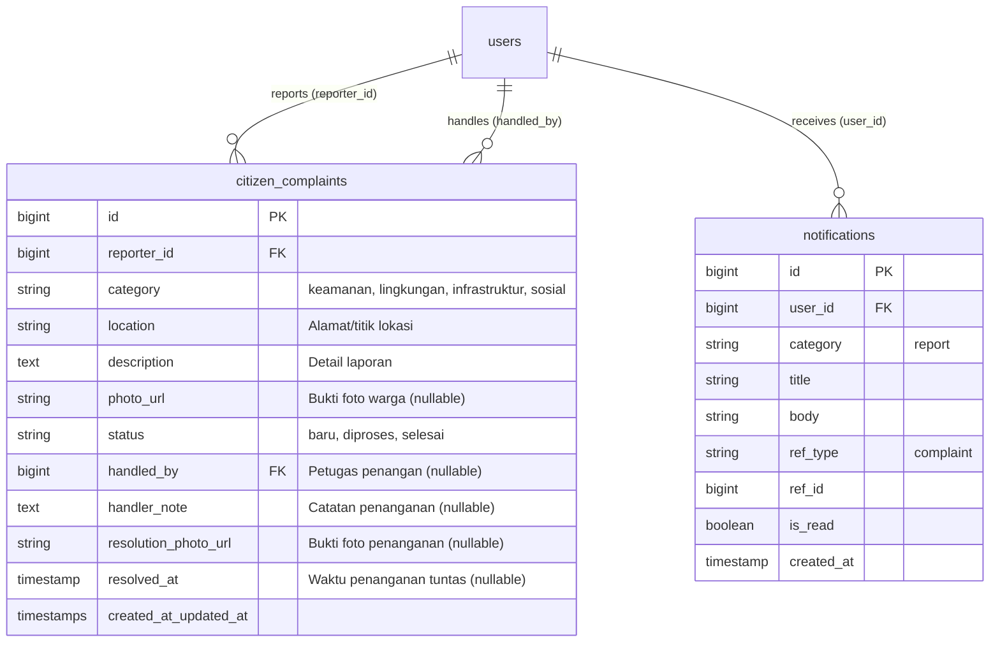
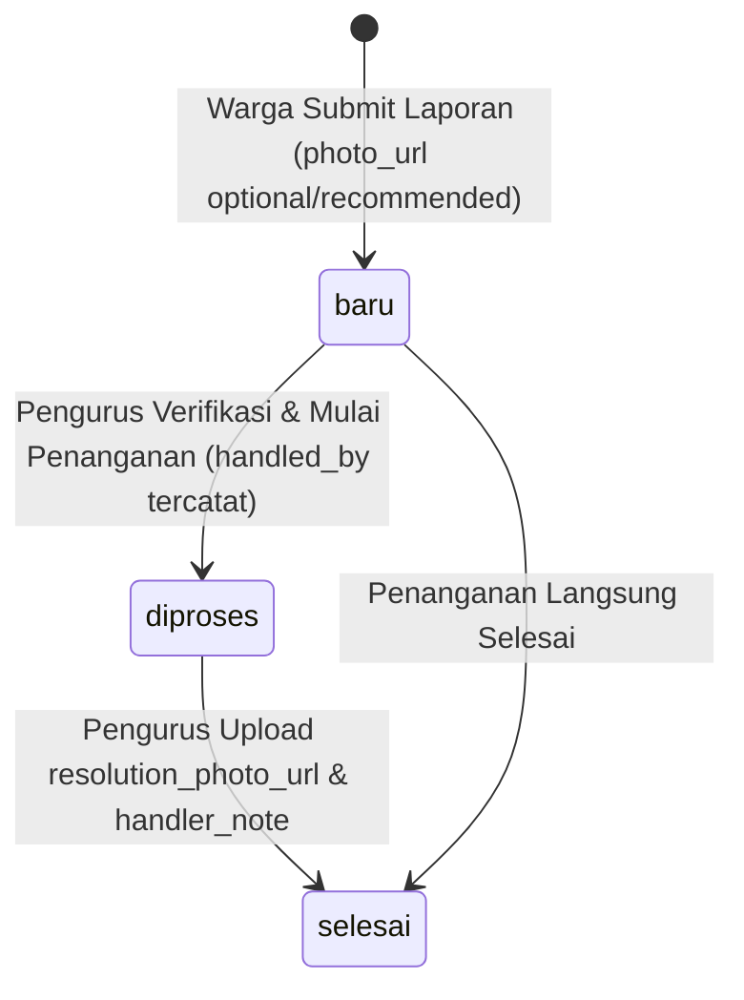

# Product Requirement Document (PRD) & Engineering Specification
## Fitur: Smart Citizen Complaint with Evidence & Resolution Tracking
**Proyek:** my23 Desa Pintar RW & Karang Taruna (`project-vilt`)  
**Versi Dokumen:** 1.0.0  
**Status:** Ready for Implementation  
**Stack:** Laravel (Backend API) & React Native Expo (Mobile App)

---

## 1. Product Requirement Document (PRD)

### 1.1 Latar Belakang & Problem Statement
Layanan Pengaduan Warga pada versi awal hanya memfasilitasi laporan berbasis teks (`category`, `location`, `description`). Dalam implementasi lapangan di tingkat RW/Desa dan Karang Taruna:
1. **Laporan Ambigu Tanpa Bukti Visual:** Laporan seperti *"lampu jalan mati"* atau *"sampah menumpuk di gang 3"* sulit diverifikasi urgensinya tanpa foto bukti (*evidence*).
2. **Ketiadaan Akuntabilitas Penanganan (No Verification Loop):** Ketika Pengurus RT/Karta menandai status laporan menjadi `selesai`, warga tidak memiliki bukti visual apakah penanganan benar-benar telah dilakukan (*Before vs After*).
3. **Penyalahgunaan & Laporan Palsu:** Formulir tanpa verifikasi foto meningkatkan kemungkinan spam laporan palsu.

### 1.2 Tujuan & Manfaat (Objectives & Key Results)
* **Objektif:** Menyediakan sistem pelaporan lingkungan dua arah yang akuntabel berbasis foto bukti dan pelacakan status penanganan real-time.
* **Key Results:**
  * 100% laporan baru memiliki opsi melampirkan foto bukti autentik via kamera/galeri.
  * 100% status penyelesaian laporan oleh pengurus dapat melampirkan foto hasil tindak lanjut (*resolution proof*).
  * Menurunkan waktu konfirmasi lokasi & verifikasi masalah oleh pengurus hingga 50%.

### 1.3 Target Persona
1. **Warga RW (Pelapor):** Mengalami atau melihat permasalahan fasilitas/keamanan lingkungan, membutuhkan kemudahan foto dan kejelasan respon pengurus.
2. **Pengurus RT / Karang Taruna (Petugas Lapangan & Verifikator):** Menerima laporan, mengecek keabsahan, menugaskan kerja bakti/perbaikan, dan mengunggah bukti penyelesaian.

### 1.4 User Stories & Acceptance Criteria

#### US-1: Warga Mengunggah Bukti Foto saat Melapor
* **Sebagai:** Warga
* **Saya ingin:** Mengambil foto langsung dari kamera atau memilih dari galeri ketika membuat pengaduan
* **Agar:** Pengurus RT dapat melihat secara persis kondisi masalah yang saya laporkan
* **Acceptance Criteria:**
  - Warga dapat memilih opsi: "Ambil Foto (Kamera)" atau "Pilih dari Galeri".
  - Terdapat preview gambar sebelum submit dengan tombol untuk mengganti/menghapus foto.
  - Sistem menolak file non-gambar atau file dengan ukuran > 5MB.
  - Pengiriman form menggunakan `multipart/form-data`.

#### US-2: Warga & Pengurus Melihat Foto Laporan
* **Sebagai:** Warga / Pengurus
* **Saya ingin:** Melihat foto yang dilampirkan pada kartu pengaduan
* **Agar:** Mengetahui konteks visual masalah sebelum turun ke lapangan
* **Acceptance Criteria:**
  - Kartu pengaduan menampilkan thumbnail gambar bukti laporan jika tersedia.
  - Gambar dapat ditekan untuk melihat tampilan penuh (preview modal).

#### US-3: Pengurus Menyelesaikan Laporan Disertai Bukti Penanganan
* **Sebagai:** Pengurus RT / Tim Penanganan Karta
* **Saya ingin:** Melampirkan foto hasil perbaikan dan catatan penanganan saat mengubah status menjadi `selesai`
* **Agar:** Warga pelapor dan warga lainnya yakin bahwa laporan telah tuntas ditindaklanjuti
* **Acceptance Criteria:**
  - Saat mengubah status menjadi `selesai`, form menyediakan opsi upload `resolution_photo`.
  - Warga menerima notifikasi bahwa laporan telah diselesaikan dan dapat melihat foto penanganan (*Before vs After*).

### 1.5 Scope & Non-Scope
* **In-Scope (MVP):**
  - Upload bukti foto oleh Warga (`photo_url`).
  - Upload bukti penanganan oleh Pengurus (`resolution_photo_url`).
  - Integrasi native hardware kamera & galeri menggunakan `expo-image-picker`.
  - Penyimpanan file lokal publik Laravel (`storage/app/public/complaints`) dengan sanitasi nama berkas.
  - Notifikasi database otomatis kepada pelapor ketika status diselesaikan.
* **Out-of-Scope (Fase Lanjutan):**
  - Watermark otomatis koordinat GPS dan timestamp pada gambar (EXIF extraction).
  - Integrasi Cloudinary/S3 (tetap menggunakan Laravel Local Storage yang modular).
  - Video stream atau audio memo.

---

## 2. Entity Relationship Diagram (ERD) & Database Schema

### 2.1 Mermaid ERD



### 2.2 Status Transition Lifecycle



### 2.3 Rincian Kolom Tabel `citizen_complaints`

| Nama Kolom | Tipe Data | Nullable | Keterangan |
| :--- | :--- | :---: | :--- |
| `id` | `BIGINT UNSIGNED` (Auto Increment) | No | Primary Key |
| `reporter_id` | `BIGINT UNSIGNED` | No | Foreign Key -> `users(id)` |
| `category` | `VARCHAR(30)` | No | `keamanan`, `lingkungan`, `infrastruktur`, `sosial` |
| `location` | `VARCHAR(150)` | No | Lokasi kejadian/masalah |
| `description` | `TEXT` | No | Uraian lengkap keluhan |
| `photo_url` | `VARCHAR(255)` | Yes | Path publik foto laporan pelapor |
| `status` | `VARCHAR(20)` | No | Default: `'baru'` (`baru`, `diproses`, `selesai`) |
| `handled_by` | `BIGINT UNSIGNED` | Yes | Foreign Key -> `users(id)` |
| `handler_note` | `VARCHAR(255)` | Yes | Catatan tindak lanjut pengurus |
| `resolution_photo_url` | `VARCHAR(255)` | Yes | **(Baru)** Bukti foto perbaikan/penyelesaian |
| `resolved_at` | `TIMESTAMP` | Yes | **(Baru)** Timestamp laporan diselesaikan |
| `created_at` / `updated_at` | `TIMESTAMP` | Yes | Timestamps bawaan Laravel |

---

## 3. Implementasi Lengkap Sisi Laravel (Backend)

### 3.1 Migration File
Simpan di: `database/migrations/2026_10_14_000001_add_resolution_fields_to_citizen_complaints_table.php`

```php
<?php

use Illuminate\Database\Migrations\Migration;
use Illuminate\Database\Schema\Blueprint;
use Illuminate\Support\Facades\Schema;

return new class extends Migration
{
    /**
     * Run the migrations.
     */
    public function up(): void
    {
        Schema::table('citizen_complaints', function (Blueprint $table) {
            $table->string('resolution_photo_url', 255)->nullable()->after('handler_note');
            $table->timestamp('resolved_at')->nullable()->after('resolution_photo_url');
        });
    }

    /**
     * Reverse the migrations.
     */
    public function down(): void
    {
        Schema::table('citizen_complaints', function (Blueprint $table) {
            $table->dropColumn(['resolution_photo_url', 'resolved_at']);
        });
    }
};
```

---

### 3.2 Update Model `CitizenComplaint.php`
Simpan di: `app/Models/CitizenComplaint.php`

```php
<?php

namespace App\Models;

use Illuminate\Database\Eloquent\Casts\Attribute;
use Illuminate\Database\Eloquent\Factories\HasFactory;
use Illuminate\Database\Eloquent\Model;
use Illuminate\Database\Eloquent\Relations\BelongsTo;

class CitizenComplaint extends Model
{
    use HasFactory;

    protected $table = 'citizen_complaints';

    protected $fillable = [
        'reporter_id',
        'category',
        'description',
        'location',
        'photo_url',
        'status',
        'handled_by',
        'handler_note',
        'resolution_photo_url',
        'resolved_at',
    ];

    protected $casts = [
        'resolved_at' => 'datetime',
    ];

    /**
     * Accessor agar URL foto selalu mengembalikan absolute URL yang bisa diakses mobile app
     */
    protected function photoUrl(): Attribute
    {
        return Attribute::make(
            get: fn (?string $value) => $value ? (filter_var($value, FILTER_VALIDATE_URL) ? $value : asset($value)) : null
        );
    }

    protected function resolutionPhotoUrl(): Attribute
    {
        return Attribute::make(
            get: fn (?string $value) => $value ? (filter_var($value, FILTER_VALIDATE_URL) ? $value : asset($value)) : null
        );
    }

    public function reporter(): BelongsTo
    {
        return $this->belongsTo(User::class, 'reporter_id');
    }

    public function handler(): BelongsTo
    {
        return $this->belongsTo(User::class, 'handled_by');
    }
}
```

---

### 3.3 Form Request Validation

#### A. `StoreComplaintRequest.php`
Simpan di: `app/Http/Requests/StoreComplaintRequest.php`

```php
<?php

namespace App\Http\Requests;

use Illuminate\Foundation\Http\FormRequest;

class StoreComplaintRequest extends FormRequest
{
    public function authorize(): bool
    {
        return true;
    }

    public function rules(): array
    {
        return [
            'category' => 'required|string|in:keamanan,lingkungan,infrastruktur,sosial,lainnya',
            'description' => 'required|string|min:10',
            'location' => 'required|string|max:150',
            'photo' => 'nullable|file|image|mimes:jpeg,png,jpg|max:5120', // Maksimal 5MB
        ];
    }

    public function messages(): array
    {
        return [
            'category.required' => 'Kategori pengaduan wajib dipilih.',
            'category.in' => 'Kategori yang dipilih tidak valid.',
            'description.required' => 'Isi pengaduan wajib diisi.',
            'description.min' => 'Isi pengaduan minimal 10 karakter.',
            'location.required' => 'Lokasi kejadian wajib diisi.',
            'photo.image' => 'Berkas bukti harus berupa gambar.',
            'photo.mimes' => 'Format gambar harus JPEG, JPG, atau PNG.',
            'photo.max' => 'Ukuran gambar maksimal 5MB.',
        ];
    }
}
```

#### B. `UpdateComplaintStatusRequest.php`
Simpan di: `app/Http/Requests/UpdateComplaintStatusRequest.php`

```php
<?php

namespace App\Http\Requests;

use Illuminate\Foundation\Http\FormRequest;

class UpdateComplaintStatusRequest extends FormRequest
{
    public function authorize(): bool
    {
        return true;
    }

    public function rules(): array
    {
        return [
            'status' => 'required|string|in:baru,diproses,selesai',
            'handler_note' => 'nullable|string|max:255',
            'resolution_photo' => 'nullable|file|image|mimes:jpeg,png,jpg|max:5120',
        ];
    }

    public function messages(): array
    {
        return [
            'status.required' => 'Status pengaduan wajib ditentukan.',
            'status.in' => 'Status hanya boleh: baru, diproses, atau selesai.',
            'resolution_photo.image' => 'Bukti penanganan harus berupa gambar.',
            'resolution_photo.max' => 'Ukuran bukti foto penanganan maksimal 5MB.',
        ];
    }
}
```

---

### 3.4 Controller Lengkap `ComplaintController.php`
Simpan di: `app/Http/Controllers/Api/ComplaintController.php`

```php
<?php

namespace App\Http\Controllers\Api;

use App\Http\Controllers\Controller;
use App\Http\Requests\StoreComplaintRequest;
use App\Http\Requests\UpdateComplaintStatusRequest;
use App\Models\CitizenComplaint;
use App\Models\Notification;
use App\Models\User;
use Illuminate\Http\JsonResponse;
use Illuminate\Http\Request;
use Illuminate\Support\Facades\DB;
use Illuminate\Support\Facades\Storage;

class ComplaintController extends Controller
{
    /**
     * List all complaints (Pengurus / RT)
     */
    public function index(): JsonResponse
    {
        $complaints = CitizenComplaint::query()
            ->with(['reporter:id,name,role', 'handler:id,name,role'])
            ->latest()
            ->get();

        return response()->json([
            'status_code' => 200,
            'status' => true,
            'message' => 'Daftar pengaduan warga berhasil diambil',
            'data' => $complaints,
        ]);
    }

    /**
     * List current user's complaints (Warga)
     */
    public function mine(Request $request): JsonResponse
    {
        $userId = $request->user()->id;
        $complaints = CitizenComplaint::query()
            ->where('reporter_id', $userId)
            ->with(['handler:id,name,role'])
            ->latest()
            ->get();

        return response()->json([
            'status_code' => 200,
            'status' => true,
            'message' => 'Pengaduan saya berhasil diambil',
            'data' => $complaints,
        ]);
    }

    /**
     * Store new complaint with photo upload (Warga)
     */
    public function store(StoreComplaintRequest $request): JsonResponse
    {
        return DB::transaction(function () use ($request) {
            $photoPath = null;

            // Upload foto bukti warga jika disertakan
            if ($request->hasFile('photo')) {
                $file = $request->file('photo');
                $filename = 'complaint_' . time() . '_' . uniqid() . '.' . $file->getClientOriginalExtension();
                $path = $file->storeAs('complaints/evidence', $filename, 'public');
                $photoPath = 'storage/' . $path;
            }

            $complaint = CitizenComplaint::create([
                'reporter_id' => $request->user()->id,
                'category' => $request->input('category'),
                'description' => $request->input('description'),
                'location' => $request->input('location'),
                'photo_url' => $photoPath,
                'status' => 'baru',
            ]);

            // Kirim notifikasi ke Pengurus & RT
            $staff = User::query()->whereIn('role', [User::ROLE_PENGURUS, User::ROLE_PENGURUS_RT])->get();
            foreach ($staff as $s) {
                Notification::create([
                    'user_id' => $s->id,
                    'category' => 'report',
                    'title' => 'Pengaduan Warga Baru: ' . ucfirst($complaint->category),
                    'body' => 'Dari ' . $request->user()->name . ' di ' . $complaint->location,
                    'ref_type' => 'complaint',
                    'ref_id' => $complaint->id,
                ]);
            }

            return response()->json([
                'status_code' => 201,
                'status' => true,
                'message' => 'Pengaduan berhasil diajukan dan bukti foto tersimpan.',
                'data' => $complaint->load('reporter:id,name'),
            ], 201);
        });
    }

    /**
     * Update complaint status, resolution note, and resolution proof photo (Pengurus / RT)
     */
    public function updateStatus(UpdateComplaintStatusRequest $request, int $id): JsonResponse
    {
        $complaint = CitizenComplaint::find($id);

        if (! $complaint) {
            return response()->json([
                'status_code' => 404,
                'status' => false,
                'message' => 'Data pengaduan tidak ditemukan',
            ], 404);
        }

        return DB::transaction(function () use ($request, $complaint) {
            $newStatus = $request->input('status');
            $complaint->status = $newStatus;
            $complaint->handled_by = $request->user()->id;

            if ($request->filled('handler_note')) {
                $complaint->handler_note = $request->input('handler_note');
            }

            // Upload foto bukti penyelesaian jika ada
            if ($request->hasFile('resolution_photo')) {
                // Hapus foto penyelesaian lama jika ada
                if ($complaint->getRawOriginal('resolution_photo_url')) {
                    $oldPath = str_replace('storage/', '', $complaint->getRawOriginal('resolution_photo_url'));
                    Storage::disk('public')->delete($oldPath);
                }

                $file = $request->file('resolution_photo');
                $filename = 'resolution_' . time() . '_' . uniqid() . '.' . $file->getClientOriginalExtension();
                $path = $file->storeAs('complaints/resolutions', $filename, 'public');
                $complaint->resolution_photo_url = 'storage/' . $path;
            }

            if ($newStatus === 'selesai' && ! $complaint->resolved_at) {
                $complaint->resolved_at = now();
            }

            $complaint->save();

            // Notifikasi kembali ke Warga Pelapor
            $statusLabel = match ($newStatus) {
                'diproses' => 'sedang dalam proses penanganan',
                'selesai' => 'telah selesai ditangani',
                default => 'diperbarui statusnya',
            };

            Notification::create([
                'user_id' => $complaint->reporter_id,
                'category' => 'report',
                'title' => 'Pengaduan Anda ' . ucfirst($newStatus),
                'body' => 'Laporan terkait ' . $complaint->location . ' ' . $statusLabel . '.',
                'ref_type' => 'complaint',
                'ref_id' => $complaint->id,
            ]);

            return response()->json([
                'status_code' => 200,
                'status' => true,
                'message' => 'Status pengaduan berhasil diperbarui',
                'data' => $complaint->load(['reporter:id,name', 'handler:id,name']),
            ]);
        });
    }
}
```

---

### 3.5 Persiapan Storage Link (Wajib Dijalankan)
Pastikan folder storage publik terhubung dengan root publik:
```bash
php artisan storage:link
```

---

## 4. Implementasi Lengkap Sisi React Expo (Mobile)

### 4.1 Dependency Requirement
Pastikan library `expo-image-picker` terinstal di proyek Expo:
```bash
npx expo install expo-image-picker
```

---

### 4.2 Update Types `project-vilt/mobile/src/types/index.ts`

Perbarui interface `CitizenComplaint`:

```typescript
export interface CitizenComplaint {
  id: number;
  reporter_id: number;
  category: 'keamanan' | 'lingkungan' | 'infrastruktur' | 'sosial' | 'lainnya' | string;
  description: string;
  location: string;
  photo_url?: string;
  resolution_photo_url?: string; // Kolom baru bukti tindak lanjut
  resolved_at?: string;          // Kolom baru timestamp selesai
  status: 'baru' | 'diproses' | 'selesai';
  handler_note?: string;
  created_at: string;
  reporter?: {
    id: number;
    name: string;
  };
  handler?: {
    id: number;
    name: string;
  };
}
```

---

### 4.3 Update API Service `project-vilt/mobile/src/services/api.ts`

Tambahkan support pengiriman multipart/form-data:

```typescript
// Sumpal/Update method submitComplaint dan updateComplaintStatus pada class ApiService

async submitComplaint(data: {
  category: string;
  description: string;
  location: string;
  photoUri?: string | null;
}): Promise<CitizenComplaint> {
  const formData = new FormData();
  formData.append('category', data.category);
  formData.append('description', data.description);
  formData.append('location', data.location);

  if (data.photoUri) {
    const filename = data.photoUri.split('/').pop() || 'evidence.jpg';
    const match = /\.(\w+)$/.exec(filename);
    const type = match ? `image/${match[1]}` : 'image/jpeg';

    // @ts-ignore - React Native FormData support
    formData.append('photo', {
      uri: data.photoUri,
      name: filename,
      type,
    });
  }

  const token = await this.getToken();
  const url = `${this.baseUrl}/complaints`;

  const response = await fetch(url, {
    method: 'POST',
    headers: {
      Authorization: token ? `Bearer ${token}` : '',
      Accept: 'application/json',
      // JANGAN set 'Content-Type' manual agar browser/engine otomatis set boundary multipart
    },
    body: formData,
  });

  const resJson = await response.json();
  if (!response.ok) {
    throw new Error(resJson.message || 'Gagal mengirim pengaduan');
  }

  return resJson.data;
}

async updateComplaintStatus(
  id: number,
  status: string,
  handler_note?: string,
  resolutionPhotoUri?: string | null
): Promise<boolean> {
  const formData = new FormData();
  formData.append('status', status);
  if (handler_note) formData.append('handler_note', handler_note);

  if (resolutionPhotoUri) {
    const filename = resolutionPhotoUri.split('/').pop() || 'resolution.jpg';
    const match = /\.(\w+)$/.exec(filename);
    const type = match ? `image/${match[1]}` : 'image/jpeg';

    // @ts-ignore
    formData.append('resolution_photo', {
      uri: resolutionPhotoUri,
      name: filename,
      type,
    });
  }

  const token = await this.getToken();
  // Untuk kompatibilitas patch multipart di Laravel, gunakan method-spoofing atau POST dengan _method
  formData.append('_method', 'PATCH');
  const url = `${this.baseUrl}/complaints/${id}/status`;

  const response = await fetch(url, {
    method: 'POST', // POST + _method: PATCH
    headers: {
      Authorization: token ? `Bearer ${token}` : '',
      Accept: 'application/json',
    },
    body: formData,
  });

  return response.ok;
}
```

---

### 4.4 Update Screen Warga `project-vilt/mobile/src/screens/warga/PengaduanScreen.tsx`

Implementasikan pemilih kamera & galeri serta preview:

```tsx
import { Ionicons } from '@expo/vector-icons';
import * as ImagePicker from 'expo-image-picker';
import React, { useEffect, useState } from 'react';
import {
  ActivityIndicator,
  Alert,
  Image,
  RefreshControl,
  ScrollView,
  StyleSheet,
  Text,
  TextInput,
  TouchableOpacity,
  View,
} from 'react-native';
import { ComplaintCard } from '../../components/ComplaintCard';
import { api } from '../../services/api';
import { colors } from '../../theme/colors';
import { CitizenComplaint } from '../../types';

export const PengaduanScreen: React.FC = () => {
  const [activeTab, setActiveTab] = useState<'create' | 'history'>('create');
  const [category, setCategory] = useState<'keamanan' | 'lingkungan' | 'infrastruktur' | 'sosial'>('lingkungan');
  const [location, setLocation] = useState('');
  const [description, setDescription] = useState('');
  const [selectedPhoto, setSelectedPhoto] = useState<string | null>(null);
  const [myComplaints, setMyComplaints] = useState<CitizenComplaint[]>([]);
  const [submitting, setSubmitting] = useState(false);
  const [loading, setLoading] = useState(true);
  const [refreshing, setRefreshing] = useState(false);

  const loadData = async () => {
    try {
      const data = await api.getMyComplaints();
      setMyComplaints(data);
    } catch {
      // handled
    } finally {
      setLoading(false);
      setRefreshing(false);
    }
  };

  useEffect(() => {
    loadData();
  }, []);

  const onRefresh = () => {
    setRefreshing(true);
    loadData();
  };

  const handlePickFromGallery = async () => {
    const permission = await ImagePicker.requestMediaLibraryPermissionsAsync();
    if (!permission.granted) {
      Alert.alert('Izin Ditolak', 'Aplikasi membutuhkan izin galeri untuk melampirkan foto bukti.');
      return;
    }

    const result = await ImagePicker.launchImageLibraryAsync({
      mediaTypes: ImagePicker.MediaTypeOptions.Images,
      allowsEditing: true,
      aspect: [4, 3],
      quality: 0.8,
    });

    if (!result.canceled && result.assets && result.assets.length > 0) {
      setSelectedPhoto(result.assets[0].uri);
    }
  };

  const handleTakePhoto = async () => {
    const permission = await ImagePicker.requestCameraPermissionsAsync();
    if (!permission.granted) {
      Alert.alert('Izin Ditolak', 'Aplikasi membutuhkan izin kamera untuk mengambil foto bukti langsung.');
      return;
    }

    const result = await ImagePicker.launchCameraAsync({
      allowsEditing: true,
      aspect: [4, 3],
      quality: 0.8,
    });

    if (!result.canceled && result.assets && result.assets.length > 0) {
      setSelectedPhoto(result.assets[0].uri);
    }
  };

  const handleSubmit = async () => {
    if (!description.trim() || !location.trim()) {
      Alert.alert('Perhatian', 'Mohon lengkapi lokasi dan uraian pengaduan.');
      return;
    }

    setSubmitting(true);
    try {
      const created = await api.submitComplaint({
        category,
        location: location.trim(),
        description: description.trim(),
        photoUri: selectedPhoto,
      });

      setMyComplaints([created, ...myComplaints]);
      setLocation('');
      setDescription('');
      setSelectedPhoto(null);
      setActiveTab('history');
      Alert.alert(
        'Laporan Terkirim',
        'Pengaduan beserta bukti foto telah tercatat dan dinotifikasikan ke Pengurus RT.'
      );
    } catch (err: any) {
      Alert.alert('Gagal Mengirim', err.message || 'Terjadi kendala saat mengirim pengaduan.');
    } finally {
      setSubmitting(false);
    }
  };

  if (loading && !refreshing) {
    return (
      <View style={styles.loadingContainer}>
        <ActivityIndicator size="large" color={colors.primary} />
        <Text style={styles.loadingText}>Memuat pusat pengaduan warga...</Text>
      </View>
    );
  }

  return (
    <ScrollView
      style={styles.container}
      contentContainerStyle={styles.scrollContent}
      refreshControl={<RefreshControl refreshing={refreshing} onRefresh={onRefresh} />}
    >
      <View style={styles.titleSection}>
        <Text style={styles.pageTitle}>Layanan Pengaduan Warga</Text>
        <Text style={styles.pageSubtitle}>
          Sampaikan keluhan fasilitas publik, keamanan lingkungan, tumpukan sampah, atau masalah sosial di RW 05.
        </Text>
      </View>

      {/* Switcher Tab */}
      <View style={styles.tabContainer}>
        <TouchableOpacity
          style={[styles.tabBtn, activeTab === 'create' && styles.tabBtnActive]}
          onPress={() => setActiveTab('create')}
        >
          <Ionicons
            name="create-outline"
            size={16}
            color={activeTab === 'create' ? colors.primary : colors.textMuted}
          />
          <Text style={[styles.tabBtnText, activeTab === 'create' && styles.tabBtnTextActive]}>
            Buat Laporan
          </Text>
        </TouchableOpacity>

        <TouchableOpacity
          style={[styles.tabBtn, activeTab === 'history' && styles.tabBtnActive]}
          onPress={() => setActiveTab('history')}
        >
          <Ionicons
            name="time-outline"
            size={16}
            color={activeTab === 'history' ? colors.primary : colors.textMuted}
          />
          <Text style={[styles.tabBtnText, activeTab === 'history' && styles.tabBtnTextActive]}>
            Riwayat Saya ({myComplaints.length})
          </Text>
        </TouchableOpacity>
      </View>

      {activeTab === 'create' ? (
        <View style={styles.formCard}>
          <Text style={styles.label}>Kategori Permasalahan</Text>
          <View style={styles.categoryRow}>
            {(['lingkungan', 'keamanan', 'infrastruktur', 'sosial'] as const).map((cat) => (
              <TouchableOpacity
                key={cat}
                style={[styles.catChip, category === cat && styles.catChipActive]}
                onPress={() => setCategory(cat)}
              >
                <Text style={[styles.catChipText, category === cat && styles.catChipTextActive]}>
                  {cat.charAt(0).toUpperCase() + cat.slice(1)}
                </Text>
              </TouchableOpacity>
            ))}
          </View>

          <Text style={styles.label}>Titik Lokasi Kejadian</Text>
          <TextInput
            style={styles.input}
            placeholder="Contoh: Depan Pos Ronda RT 02 / Lapangan RW"
            placeholderTextColor={colors.textLight}
            value={location}
            onChangeText={setLocation}
          />

          <Text style={styles.label}>Uraian Pengaduan</Text>
          <TextInput
            style={[styles.input, styles.textArea]}
            placeholder="Jelaskan detail permasalahan yang Anda temukan..."
            placeholderTextColor={colors.textLight}
            value={description}
            onChangeText={setDescription}
            multiline
            numberOfLines={4}
            textAlignVertical="top"
          />

          {/* Lampiran Bukti Foto */}
          <Text style={styles.label}>Lampiran Bukti Foto</Text>
          {selectedPhoto ? (
            <View style={styles.previewContainer}>
              <Image source={{ uri: selectedPhoto }} style={styles.previewImage} />
              <TouchableOpacity
                style={styles.removePhotoBtn}
                onPress={() => setSelectedPhoto(null)}
              >
                <Ionicons name="trash-outline" size={16} color="#FFF" />
                <Text style={styles.removePhotoText}>Hapus Foto</Text>
              </TouchableOpacity>
            </View>
          ) : (
            <View style={styles.photoActionsRow}>
              <TouchableOpacity style={styles.photoPickBtn} onPress={handleTakePhoto}>
                <Ionicons name="camera-outline" size={20} color={colors.primary} />
                <Text style={styles.photoPickBtnText}>Buka Kamera</Text>
              </TouchableOpacity>
              <TouchableOpacity style={styles.photoPickBtn} onPress={handlePickFromGallery}>
                <Ionicons name="images-outline" size={20} color={colors.primary} />
                <Text style={styles.photoPickBtnText}>Pilih Galeri</Text>
              </TouchableOpacity>
            </View>
          )}

          <TouchableOpacity
            style={[styles.submitBtn, submitting && styles.btnDisabled]}
            onPress={handleSubmit}
            disabled={submitting}
          >
            {submitting ? (
              <ActivityIndicator color="#FFF" />
            ) : (
              <>
                <Ionicons name="paper-plane" size={18} color="#FFF" />
                <Text style={styles.submitBtnText}>Kirim Pengaduan</Text>
              </>
            )}
          </TouchableOpacity>
        </View>
      ) : (
        <View style={styles.listContainer}>
          {myComplaints.length === 0 ? (
            <View style={styles.emptyBox}>
              <Ionicons name="chatbubbles-outline" size={48} color={colors.textLight} />
              <Text style={styles.emptyTitle}>Belum Ada Pengaduan</Text>
              <Text style={styles.emptySub}>
                Semua laporan yang Anda ajukan akan muncul di sini beserta status penanganannya.
              </Text>
            </View>
          ) : (
            myComplaints.map((item) => <ComplaintCard key={item.id} complaint={item} />)
          )}
        </View>
      )}
    </ScrollView>
  );
};

const styles = StyleSheet.create({
  container: { flex: 1, backgroundColor: colors.background },
  scrollContent: { padding: 16, paddingBottom: 40 },
  loadingContainer: { flex: 1, justifyContent: 'center', alignItems: 'center' },
  loadingText: { marginTop: 12, color: colors.textMuted },
  titleSection: { marginBottom: 16 },
  pageTitle: { fontSize: 20, fontWeight: '700', color: colors.textDark },
  pageSubtitle: { fontSize: 13, color: colors.textMuted, marginTop: 4, lineHeight: 18 },
  tabContainer: {
    flexDirection: 'row',
    backgroundColor: colors.surfaceSubtle,
    borderRadius: 10,
    padding: 4,
    marginBottom: 16,
  },
  tabBtn: {
    flex: 1,
    flexDirection: 'row',
    alignItems: 'center',
    justifyContent: 'center',
    paddingVertical: 10,
    borderRadius: 8,
    gap: 6,
  },
  tabBtnActive: { backgroundColor: colors.surface, elevation: 1 },
  tabBtnText: { fontSize: 13, color: colors.textMuted, fontWeight: '500' },
  tabBtnTextActive: { color: colors.primary, fontWeight: '700' },
  formCard: {
    backgroundColor: colors.surface,
    borderRadius: 12,
    padding: 16,
    borderWidth: 1,
    borderColor: colors.borderLight,
  },
  label: { fontSize: 13, fontWeight: '600', color: colors.textDark, marginBottom: 8, marginTop: 12 },
  categoryRow: { flexDirection: 'row', flexWrap: 'wrap', gap: 8 },
  catChip: {
    paddingHorizontal: 12,
    paddingVertical: 7,
    borderRadius: 8,
    backgroundColor: colors.surfaceSubtle,
    borderWidth: 1,
    borderColor: colors.borderLight,
  },
  catChipActive: { backgroundColor: colors.primaryLight, borderColor: colors.primary },
  catChipText: { fontSize: 12, color: colors.textMuted },
  catChipTextActive: { color: colors.primary, fontWeight: '600' },
  input: {
    borderWidth: 1,
    borderColor: colors.borderLight,
    borderRadius: 8,
    paddingHorizontal: 12,
    paddingVertical: 10,
    fontSize: 14,
    color: colors.textDark,
    backgroundColor: colors.surfaceSubtle,
  },
  textArea: { height: 90 },
  photoActionsRow: { flexDirection: 'row', gap: 12 },
  photoPickBtn: {
    flex: 1,
    flexDirection: 'row',
    alignItems: 'center',
    justifyContent: 'center',
    paddingVertical: 12,
    borderRadius: 8,
    borderWidth: 1,
    borderColor: colors.primaryLight,
    backgroundColor: colors.surfaceSubtle,
    gap: 8,
  },
  photoPickBtnText: { fontSize: 13, color: colors.primary, fontWeight: '600' },
  previewContainer: { borderRadius: 10, overflow: 'hidden', borderWidth: 1, borderColor: colors.borderLight },
  previewImage: { width: '100%', height: 180 },
  removePhotoBtn: {
    flexDirection: 'row',
    alignItems: 'center',
    justifyContent: 'center',
    backgroundColor: colors.danger,
    paddingVertical: 8,
    gap: 6,
  },
  removePhotoText: { color: '#FFF', fontSize: 12, fontWeight: '600' },
  submitBtn: {
    flexDirection: 'row',
    alignItems: 'center',
    justifyContent: 'center',
    backgroundColor: colors.primary,
    borderRadius: 10,
    paddingVertical: 14,
    marginTop: 20,
    gap: 8,
  },
  btnDisabled: { opacity: 0.6 },
  submitBtnText: { color: '#FFF', fontSize: 14, fontWeight: '700' },
  listContainer: { gap: 12 },
  emptyBox: { alignItems: 'center', paddingVertical: 40 },
  emptyTitle: { fontSize: 16, fontWeight: '600', color: colors.textDark, marginTop: 12 },
  emptySub: { fontSize: 12, color: colors.textMuted, textAlign: 'center', marginTop: 4, paddingHorizontal: 20 },
});
```

---

### 4.5 Update Component `project-vilt/mobile/src/components/ComplaintCard.tsx`

Tampilkan foto bukti dari warga dan foto penyelesaian dari pengurus (*Before & After*):

```tsx
import { Ionicons } from '@expo/vector-icons';
import * as ImagePicker from 'expo-image-picker';
import React, { useState } from 'react';
import {
  Image,
  Modal,
  StyleSheet,
  Text,
  TextInput,
  TouchableOpacity,
  View,
} from 'react-native';
import { colors } from '../theme/colors';
import { CitizenComplaint } from '../types';

interface ComplaintCardProps {
  complaint: CitizenComplaint;
  isStaff?: boolean;
  onUpdateStatus?: (
    id: number,
    status: 'baru' | 'diproses' | 'selesai',
    note?: string,
    photoUri?: string | null
  ) => void;
}

export const ComplaintCard: React.FC<ComplaintCardProps> = ({
  complaint,
  isStaff = false,
  onUpdateStatus,
}) => {
  const [showActionBox, setShowActionBox] = useState(false);
  const [handlerNote, setHandlerNote] = useState('');
  const [resolutionPhoto, setResolutionPhoto] = useState<string | null>(null);
  const [previewModalUrl, setPreviewModalUrl] = useState<string | null>(null);

  const getStatusMeta = () => {
    switch (complaint.status) {
      case 'baru':
        return { label: 'Laporan Baru', bg: colors.dangerLight, color: colors.danger };
      case 'diproses':
        return { label: 'Sedang Ditangani', bg: colors.warningLight, color: colors.warning };
      case 'selesai':
        return { label: 'Selesai', bg: colors.successLight, color: colors.success };
      default:
        return { label: complaint.status, bg: colors.surfaceSubtle, color: colors.textMuted };
    }
  };

  const handlePickResolutionPhoto = async () => {
    const result = await ImagePicker.launchCameraAsync({
      allowsEditing: true,
      aspect: [4, 3],
      quality: 0.8,
    });

    if (!result.canceled && result.assets && result.assets.length > 0) {
      setResolutionPhoto(result.assets[0].uri);
    }
  };

  const statusMeta = getStatusMeta();

  return (
    <View style={styles.card}>
      <View style={styles.header}>
        <View style={styles.catRow}>
          <Ionicons name="alert-circle-outline" size={16} color={colors.primary} />
          <Text style={styles.catText}>{complaint.category.toUpperCase()}</Text>
        </View>
        <View style={[styles.statusBadge, { backgroundColor: statusMeta.bg }]}>
          <Text style={[styles.statusText, { color: statusMeta.color }]}>{statusMeta.label}</Text>
        </View>
      </View>

      <Text style={styles.description}>{complaint.description}</Text>

      <View style={styles.locationRow}>
        <Ionicons name="location-outline" size={13} color={colors.textLight} />
        <Text style={styles.locationText}>{complaint.location}</Text>
      </View>

      {/* Foto Bukti Laporan Warga (Before) */}
      {complaint.photo_url && (
        <View style={styles.photoContainer}>
          <Text style={styles.photoLabel}>Bukti Laporan Awal:</Text>
          <TouchableOpacity onPress={() => setPreviewModalUrl(complaint.photo_url || null)}>
            <Image source={{ uri: complaint.photo_url }} style={styles.complaintImage} />
          </TouchableOpacity>
        </View>
      )}

      {/* Catatan & Foto Penyelesaian Petugas/RT (After) */}
      {complaint.status === 'selesai' && (
        <View style={styles.resolutionBox}>
          <View style={styles.noteHeader}>
            <Ionicons name="checkmark-done-circle" size={16} color={colors.success} />
            <Text style={styles.resolutionTitle}>Telah Ditangani oleh RT / Karta</Text>
          </View>
          {complaint.handler_note && (
            <Text style={styles.noteContent}>{complaint.handler_note}</Text>
          )}
          {complaint.resolution_photo_url && (
            <View style={{ marginTop: 8 }}>
              <Text style={styles.photoLabel}>Bukti Hasil Penanganan (Tuntas):</Text>
              <TouchableOpacity onPress={() => setPreviewModalUrl(complaint.resolution_photo_url || null)}>
                <Image source={{ uri: complaint.resolution_photo_url }} style={styles.complaintImage} />
              </TouchableOpacity>
            </View>
          )}
        </View>
      )}

      {/* Staff Actions (Pengurus / RT) */}
      {isStaff && onUpdateStatus && (
        <View style={styles.staffActionSection}>
          <TouchableOpacity
            style={styles.toggleActionBtn}
            onPress={() => setShowActionBox(!showActionBox)}
          >
            <Ionicons name="hammer-outline" size={14} color={colors.primary} />
            <Text style={styles.toggleActionText}>
              {showActionBox ? 'Tutup Aksi Penanganan' : 'Tindak Lanjut / Selesaikan Laporan'}
            </Text>
          </TouchableOpacity>

          {showActionBox && (
            <View style={styles.actionForm}>
              <Text style={styles.actionLabel}>Catatan Petugas / Solusi Lapangan:</Text>
              <TextInput
                style={styles.actionInput}
                placeholder="Misal: Sudah dibersihkan bersama warga RT 02..."
                placeholderTextColor={colors.textLight}
                value={handlerNote}
                onChangeText={setHandlerNote}
                multiline
              />

              <TouchableOpacity style={styles.photoActionBtn} onPress={handlePickResolutionPhoto}>
                <Ionicons name="camera" size={16} color={colors.primary} />
                <Text style={styles.photoActionBtnText}>
                  {resolutionPhoto ? 'Ganti Foto Bukti Selesai' : 'Ambil Foto Bukti Selesai'}
                </Text>
              </TouchableOpacity>

              {resolutionPhoto && (
                <Image source={{ uri: resolutionPhoto }} style={styles.miniResolutionPreview} />
              )}

              <View style={styles.actionBtnRow}>
                <TouchableOpacity
                  style={[styles.btnAction, { backgroundColor: colors.warning }]}
                  onPress={() => {
                    onUpdateStatus(complaint.id, 'diproses', handlerNote);
                    setShowActionBox(false);
                  }}
                >
                  <Text style={styles.btnActionText}>Set Diproses</Text>
                </TouchableOpacity>

                <TouchableOpacity
                  style={[styles.btnAction, { backgroundColor: colors.success }]}
                  onPress={() => {
                    onUpdateStatus(complaint.id, 'selesai', handlerNote, resolutionPhoto);
                    setShowActionBox(false);
                  }}
                >
                  <Text style={styles.btnActionText}>Selesaikan Laporan</Text>
                </TouchableOpacity>
              </View>
            </View>
          )}
        </View>
      )}

      {/* Lightbox Preview Modal */}
      <Modal visible={!!previewModalUrl} transparent animationType="fade">
        <View style={styles.modalBg}>
          <TouchableOpacity style={styles.modalCloseBtn} onPress={() => setPreviewModalUrl(null)}>
            <Ionicons name="close" size={28} color="#FFF" />
          </TouchableOpacity>
          {previewModalUrl && (
            <Image source={{ uri: previewModalUrl }} style={styles.modalFullImage} resizeMode="contain" />
          )}
        </View>
      </Modal>
    </View>
  );
};

const styles = StyleSheet.create({
  card: {
    backgroundColor: colors.surface,
    borderRadius: 12,
    padding: 16,
    marginBottom: 12,
    borderWidth: 1,
    borderColor: colors.borderLight,
  },
  header: { flexDirection: 'row', justifyContent: 'space-between', alignItems: 'center' },
  catRow: { flexDirection: 'row', alignItems: 'center', gap: 6 },
  catText: { fontSize: 12, fontWeight: '700', color: colors.primary },
  statusBadge: { paddingHorizontal: 8, paddingVertical: 4, borderRadius: 6 },
  statusText: { fontSize: 11, fontWeight: '700' },
  description: { fontSize: 14, color: colors.textDark, marginTop: 8, lineHeight: 20 },
  locationRow: { flexDirection: 'row', alignItems: 'center', gap: 4, marginTop: 8 },
  locationText: { fontSize: 12, color: colors.textMuted },
  photoContainer: { marginTop: 12 },
  photoLabel: { fontSize: 11, color: colors.textMuted, marginBottom: 4, fontWeight: '600' },
  complaintImage: { width: '100%', height: 160, borderRadius: 8 },
  resolutionBox: {
    backgroundColor: '#F0FDF4',
    borderWidth: 1,
    borderColor: '#BBF7D0',
    borderRadius: 8,
    padding: 12,
    marginTop: 12,
  },
  noteHeader: { flexDirection: 'row', alignItems: 'center', gap: 6, marginBottom: 4 },
  resolutionTitle: { fontSize: 12, fontWeight: '700', color: colors.success },
  noteContent: { fontSize: 13, color: colors.textDark, lineHeight: 18 },
  staffActionSection: { marginTop: 12, borderTopWidth: 1, borderTopColor: colors.borderLight, paddingTop: 10 },
  toggleActionBtn: { flexDirection: 'row', alignItems: 'center', gap: 6 },
  toggleActionText: { fontSize: 12, color: colors.primary, fontWeight: '600' },
  actionForm: { marginTop: 10, gap: 8 },
  actionLabel: { fontSize: 12, color: colors.textMuted, fontWeight: '500' },
  actionInput: {
    borderWidth: 1,
    borderColor: colors.borderLight,
    borderRadius: 8,
    padding: 8,
    fontSize: 13,
    backgroundColor: colors.surfaceSubtle,
    height: 60,
  },
  photoActionBtn: {
    flexDirection: 'row',
    alignItems: 'center',
    gap: 6,
    paddingVertical: 8,
    paddingHorizontal: 12,
    backgroundColor: colors.surfaceSubtle,
    borderRadius: 6,
    alignSelf: 'flex-start',
  },
  photoActionBtnText: { fontSize: 12, color: colors.primary, fontWeight: '600' },
  miniResolutionPreview: { width: 80, height: 80, borderRadius: 6 },
  actionBtnRow: { flexDirection: 'row', gap: 8, marginTop: 4 },
  btnAction: { flex: 1, paddingVertical: 10, borderRadius: 6, alignItems: 'center' },
  btnActionText: { color: '#FFF', fontSize: 12, fontWeight: '700' },
  modalBg: { flex: 1, backgroundColor: 'rgba(0,0,0,0.9)', justifyContent: 'center', alignItems: 'center' },
  modalCloseBtn: { position: 'absolute', top: 40, right: 20, zIndex: 10 },
  modalFullImage: { width: '90%', height: '80%' },
});
```

---

## 5. Rencana Pengujian & Quality Assurance (QA)

### 5.1 Manual Testing Checklist via cURL / Postman

#### 1. Uji Coba Lapor Baru dengan File Gambar
```bash
curl -X POST http://localhost:8000/api/complaints \
  -H "Authorization: Bearer <TOKEN_WARGA>" \
  -H "Accept: application/json" \
  -F "category=lingkungan" \
  -F "location=Gang Belimbing RT 04" \
  -F "description=Sampah menumpuk sejak 3 hari belum diangkut" \
  -F "photo=@/path/to/evidence.jpg"
```
*Expected Result:* HTTP 201 Created, mengembalikan `photo_url` dengan format `http://.../storage/complaints/evidence/...`.

#### 2. Uji Coba Pengurus Menyelesaikan Laporan dengan Foto Bukti Selesai
```bash
curl -X POST http://localhost:8000/api/complaints/1/status \
  -H "Authorization: Bearer <TOKEN_PENGURUS>" \
  -H "Accept: application/json" \
  -F "_method=PATCH" \
  -F "status=selesai" \
  -F "handler_note=Sudah dibersihkan dan diangkut oleh tim kebersihan RT" \
  -F "resolution_photo=@/path/to/resolution.jpg"
```
*Expected Result:* HTTP 200 OK, `status: 'selesai'`, `resolved_at` terisi timestamp, `resolution_photo_url` terisi.

---

Dokumen ini siap dijadikan acuan tunggal pengerjaan fitur pengaduan warga berbukti foto end-to-end pada Laravel dan React Expo Anda.
